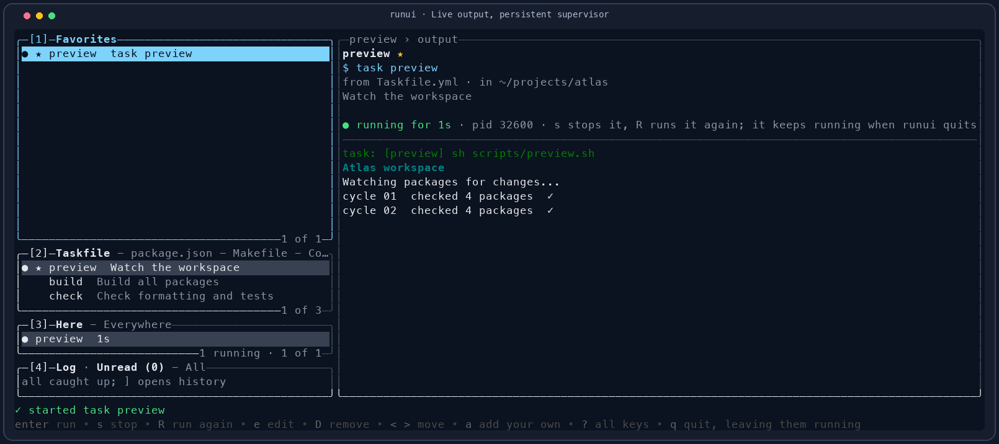

# Runui


**Your project's commands, ready to run.** Taskfile tasks, package scripts, Make targets, Compose services, and Maven builds are scattered across files. Runui gathers them in one terminal screen. Pick a command, watch its output, then close the interface whenever you like. The command keeps running, and its output is waiting when you return.


[Explore the illustrated guide](docs/index.html) for the full tour.

## Install

With Homebrew on macOS or Linux:

```sh
brew tap lechero/runui https://github.com/lechero/runui.git
brew install lechero/runui/runui
```

This builds Runui from source and installs Rust as a build dependency. To build from a clone with Rust 1.88 or newer:

```sh
task install
```

This installs `runui` to `~/.local/bin`. Without [Task](https://taskfile.dev):

```sh
cargo install --path crates/runui --root ~/.local --locked
```

Make sure `~/.local/bin` is on your `PATH`. Commands discovered in a project use that project's tools, such as `task`, a package manager, `make`, `docker compose`, or Maven.

## Start here

```sh
runui                   # open the interface for the current project
runui -C ~/projects/app  # open another project
runui list              # print its favorites, commands, and runs
runui ps                # print runs from all folders, live ones first
runui status            # print counts for a terminal status line
runui status clear      # dismiss finished counts, keeping runs and output
runui mcp -C ~/projects/app  # serve tools to an MCP client over stdio
```

Opening from `src/` or another subfolder selects the nearest parent with a supported project file, up to the repository root. The Project panel also finds files in folders below it, three levels deep, so commands from `apps/web` or a Maven module appear with their folder and run there.

### Where commands come from

| Project file | Commands runui offers |
| --- | --- |
| `Taskfile.yml` | Tasks, including named tasks from included Taskfiles; internal tasks are hidden. |
| `package.json` | Scripts through its declared package manager or the nearest lock file's manager: pnpm, yarn, bun, or npm. |
| `Makefile` | Targets, with `##` comments as descriptions. |
| `compose.yaml` and other Compose files | `up`, `up --build`, `down`, `ps`, `logs -f`, and `up` for each service. |
| `pom.xml` | `clean install`, `clean verify`, `test`, and builds for non-default profiles; uses `mvnw` when present. |

Use `m` to star a discovered command for this folder, or `a` to add your own shell command. Favorites are saved per folder.


## A typical session

1. Select a command with `j`/`k`, or switch panels with `tab` and source tabs with `[`/`]`.
2. Press `enter` to run it. Output appears on the right as the command prints it.
3. Press `q` when you are done looking. The run keeps going under its own supervisor.
4. Open runui again to follow the same output. Press `s` to stop it or `R` to restart it.



The Runs panel has **Here** and **Everywhere** tabs, and an **Agents** tab once an agent has started a run through `runui mcp`. `●` means running, `✓` exited successfully, `✗` failed, `■` was stopped, and `?` means runui lost track of it.

### Keys at a glance

| Keys | Action |
| --- | --- |
| `tab` / `shift+tab`, `1`–`3` | Move between Favorites, Project, and Runs. |
| `[` / `]` | Switch source tabs or Here / Everywhere / Agents. |
| `j` / `k`, `g` / `G` | Move through rows. |
| `/` | Filter rows by name, folder, command, or description. |
| `enter` | Run a command; on a run, focus its output. |
| `s` / `R` | Stop or restart a run. |
| `m` / `a` / `e` / `D` | Star, add, edit, or remove a favorite; `D` also forgets an ended run. |
| `0`, `esc`, `+` / `_` | Focus output, return to a panel, or expand / restore the output. |
| `?` | Show every key in the app. |
| `q` | Quit while runs continue. |

The interface also supports mouse selection and scrolling. [The guide](docs/index.html#keyboard) covers output scrolling, copying commands, refreshing files, and favorite order.

## Runs and data

Each command runs in its own folder through `sh -c` (and through `mise exec` when mise is available). A separate supervisor keeps it alive after runui or its terminal closes. It records output and the final state, and stops the command's process group with SIGTERM followed by SIGKILL after five seconds if needed.

| Data | Default location | Override |
| --- | --- | --- |
| Favorites | `~/.config/runui/favorites.json` | `$XDG_CONFIG_HOME/runui/favorites.json` |
| Runs and output | `~/.local/state/runui/runs` | `$XDG_STATE_HOME/runui/runs` |

Runui keeps up to forty ended runs across folders. Their output remains available until the run is forgotten or pruned.

### Status line

`runui status` reads all stored runs and prints one stable, shell-friendly line:

```text
running=2 completed=1 errored=0
```

Starting and active commands count as running. A command that exits with code 0 counts as completed; a nonzero exit, failed start, or lost supervisor counts as errored. Runs deliberately stopped with `s` are omitted. The counts cover all folders. Finished results stay counted until you focus their output pane in Runui (enter on a run, `0`, or click the pane), or run `runui status clear` to dismiss all finished counts. A run already in the focused pane is dismissed when it finishes. Dismissing a count keeps the run and its output; running counts always reflect active commands. The output is designed for tmux and other status bars, which can omit zero values.

## Use with an agent

Run `runui mcp -C /absolute/path/to/project` as a local MCP stdio server. Point your agent's MCP client at the installed `runui` binary with those arguments. The server offers `list_commands`, `start_run`, `list_runs`, `get_run`, `read_output`, and `stop_run` tools. A run started by an agent appears in the TUI, in the Agents tab under the name its MCP client gives, and keeps running after the MCP client disconnects; runs started in the TUI are available through the same tools.

`start_run` accepts a shell command and optional working directory and label. `list_commands` returns the exact command and directory for discovered project commands and favorites. `read_output` returns recent plain text, up to 500 lines and 64 KiB per call; call it again to follow a live run. Runs come back with the `agent` that started them and their `output_file`, everything the run printed, for a client that would rather read it itself. The [MCP guide](docs/index.html#mcp) has a client configuration example and the full tool reference.

## Develop

```sh
task build     # build bin/runui
task run       # build and open runui in the current folder
task test      # workspace tests and clippy
task lint      # clippy and rustfmt checks
```

The CI workflow checks tests, formatting, and Clippy on macOS and Linux. A `v*` tag runs the release workflow, which publishes archives for macOS and Linux. Documentation captures can be regenerated with `python3 scripts/capture-docs.py` after `task build` (requires tmux and Pillow). The capture script uses a temporary home and project. Raster brand exports come from `python3 scripts/build-brand-assets.py` (requires Pillow and librsvg).

For the implementation layout, see [AGENTS.md](AGENTS.md). The [brand kit](docs/brand.html) contains the vector logo, icons, and social preview. License: [MIT](LICENSE).
