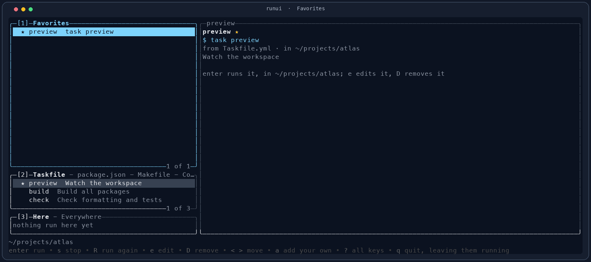
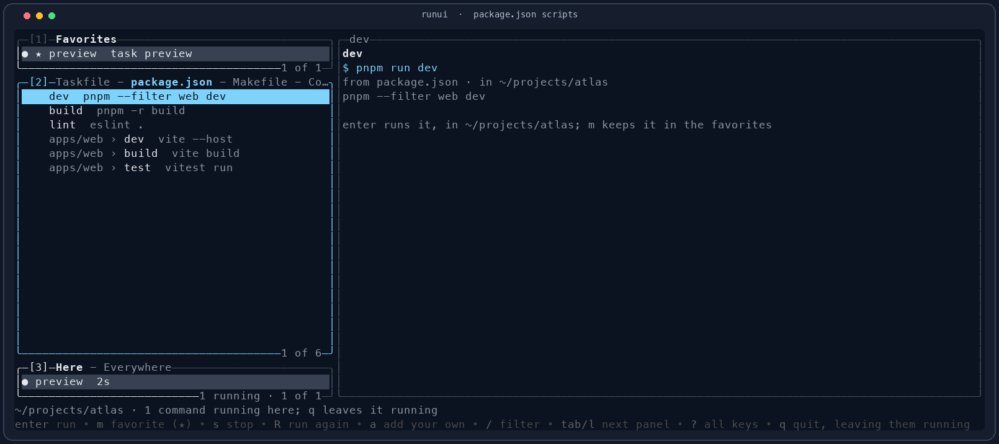
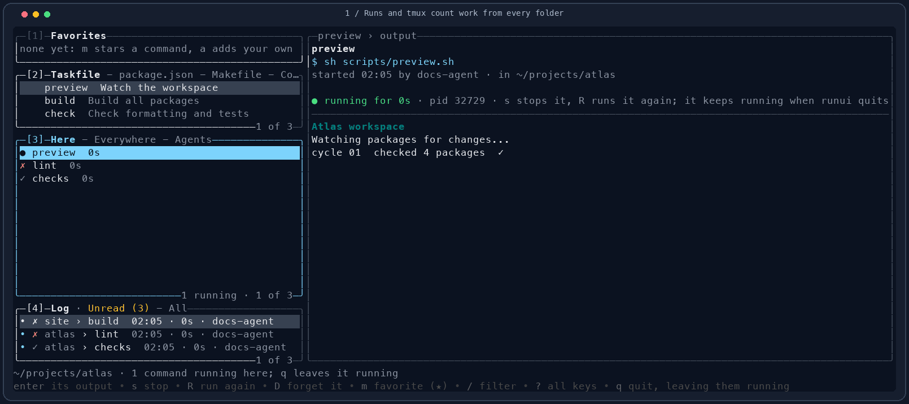
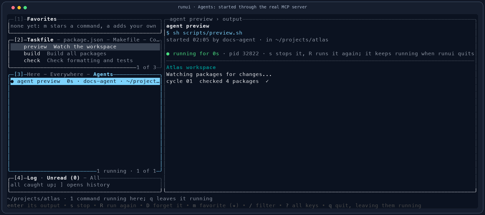
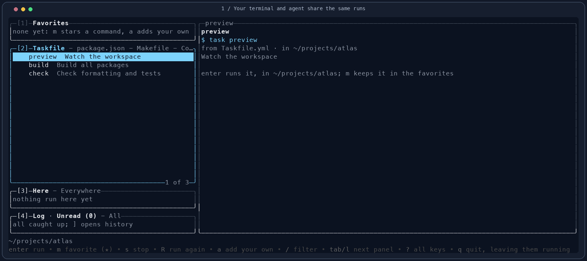

# Runui


**Find the command. Keep the run. Come back to its output.**

Runui brings your project commands, persistent processes, finished history, and agent runs into one Rust terminal app. Discover tasks and scripts across nested folders, star the ones you use, and follow their output. Close runui whenever you like; its supervisors keep the work going.

[Illustrated guide](docs/index.html) · [MCP setup](#give-your-agent-the-same-tools) · [Log & history](#a-log-you-can-come-back-to) · [Keyboard reference](#keys-at-a-glance) · [Brand kit](docs/brand.html)



| Find | Run | Review | Share with an agent |
| --- | --- | --- | --- |
| Five command sources, nested folders, filters, and per-project favorites. | Live output under a supervisor that outlives the app and terminal. | A global Log of successes, failures, stopped runs, and repeated attempts. | Six local MCP tools using the same processes, metadata, and output. |

## Install & open

With Homebrew on macOS or Linux:

```sh
brew tap lechero/runui https://github.com/lechero/runui.git
brew install lechero/runui/runui
runui
```

Homebrew builds from source and installs Rust as a build dependency. To build the current source yourself, use Rust 1.88 or newer:

```sh
git clone https://github.com/lechero/runui.git
cd runui
cargo install --path crates/runui --root ~/.local --locked
```

Or run `task install` from the clone. Put `~/.local/bin` on your `PATH`. Discovered commands use the project's own tools: Task, a package manager, Make, Docker Compose, or Maven.

```sh
runui                       # open the current project
runui -C ~/projects/atlas    # choose another project
runui list                  # print favorites, commands, and this project's runs
runui ps                    # show runs from every folder, live ones first
```

Opening inside `src/` or another subfolder selects the nearest parent with a supported project file, up to the repository root. Discovery includes folders three levels below the selected project; commands from `apps/web` appear with their folder and run there.

## Four panels, one workspace

| Key | Panel | What's there |
| --- | --- | --- |
| `1` | **Favorites** | Starred project commands and shell commands of your own, saved per project. |
| `2` | **Project** | Taskfile, package.json, Makefile, Compose, and Maven tabs. Filter a tab with `/`. |
| `3` | **Runs** | **Here**, **Everywhere**, and an **Agents** tab once MCP runs exist. Read, stop, or restart the same processes. |
| `4` | **Log** | **Unread** results needing a look and **All** retained finished attempts, across every folder. |

Use `tab` / `shift+tab` between panels and `[` / `]` between a panel's tabs. Press `?` for the full in-app key sheet. Mouse selection and scrolling work too.

### Commands already in your project

| Source | Commands offered |
| --- | --- |
| `Taskfile.yml` | Tasks and namespaced includes, with descriptions; internal tasks stay hidden. |
| `package.json` | Scripts through pnpm, yarn, bun, or npm, selected by `packageManager` or the nearest lock file. |
| `Makefile` | Targets, with `##` comments as descriptions. |
| Compose files | `up`, `up --build`, `down`, `ps`, `logs -f`, and `up` for individual services. |
| `pom.xml` | Install, verify, test, and non-default profile builds; uses `mvnw` when present. |



Press `m` to star a command, or `a` to save your own named shell command. Runui notices edits to files it reads; `r` rescans, including newly added nested files. A shared palette, workspace and registered-project search, Composer scripts, Cargo commands, and opt-in shell recall are [planned](docs/command-discovery-plan.md); today's `/` filter applies to the current tab.

## Run now, return later

1. Choose a command with `j` / `k`, then press `enter`.
2. Follow its output. Press `q` or close the terminal while work continues.
3. Reopen runui to find the same process and stored output.
4. Press `s` to stop it, or `R` to start a fresh attempt.

Every run uses its own working directory and supervisor. `●` is running, `✓` exited successfully, `✗` failed, `■` was deliberately stopped, and `?` means its supervisor disappeared without a final result.

## A Log you can come back to

Press **`4`**. **Unread** gathers successful, failed, and lost results from **every folder**, including runs started by an agent. A `•` marks an unread result. Selecting a row previews its output and clears that result's completion or error notice in tmux. The output pane does not need focus.

The selected result stays while you read; refreshes do not silently review the next one. If a live run finishes while its output is visible, it is reviewed then. **Running processes keep their counts.**

Switch to **All** with `]` to revisit reviewed and stopped runs, newest finish first. Repeat attempts keep their own output and review state. Filter by command, folder, outcome (`completed`, `failed`, `lost`, `stopped`), or agent; use `R` to follow a new attempt in Runs, `y` to copy its command, or `D` to forget an ended run and its output.

<details>
<summary>Watch: review results, clear notices, keep the history</summary>



</details>

[Still screenshot](docs/assets/log.png) · [Play or pause the demo in the guide](docs/index.html#log)

## Give your agent the same tools

Runui includes a local **MCP stdio server**. An agent can discover exact commands and working directories, start persistent runs, follow output, and stop processes. You can inspect those same runs in **Runs → Agents**, identified by the MCP client's name, and review their finished results in Log.

Configure your client's MCP server settings with the absolute binary and project paths. For clients using `mcpServers`:

```json
{
  "mcpServers": {
    "runui": {
      "command": "/Users/you/.local/bin/runui",
      "args": ["mcp", "-C", "/Users/you/projects/atlas"]
    }
  }
}
```

Use your installed paths (`command -v runui`), including `/home/you/…` on Linux. Client configuration shapes vary; the launch command is always `runui mcp -C /absolute/project`. There is no network listener or API key to configure.

| Tool | Inputs | Result |
| --- | --- | --- |
| `list_commands` | `{}` | Discovered commands and favorites, exact shell commands and directories, and file-reading errors. |
| `start_run` | `command`; optional `directory`, `name` | A supervised run and its ID. Directories may be absolute or relative to the selected project. |
| `list_runs` | Optional `directory` | Runs from every folder, newest first; the optional filter matches one exact working directory. |
| `get_run` | `id` | State, timestamps, exit code, agent, output path, and other metadata. |
| `read_output` | `id`; optional `lines` | Latest plain-text tail and state: 100 lines by default, up to 500 lines and 64 KiB. Poll again to follow output. |
| `stop_run` | `id` | A stop request; poll `get_run` for the final state. |



<details>
<summary>Watch: MCP starts work, the TUI follows it, and Log keeps the result</summary>



</details>

The client name comes from MCP's `initialize.clientInfo.name`. Run metadata includes `agent` and `output_file`; the latter points to the complete raw output file. Closing runui or disconnecting the MCP client leaves its runs alive. TUI-started runs are available through the same tools.

MCP reads do not clear completion or error notices: view the result in the TUI or use `runui status clear`. The [guide](docs/index.html#mcp) includes tool-call examples and the discover → start → follow → stop workflow.

## Quiet tmux counters

```tmux
set -g status-interval 5
set -ag status-right '#(runui status tmux)'
```

`▶` counts active runs in blue, `✓` unread successes in green, and `✗` unread failures or lost runs in red. Each zero segment disappears; when all are zero, the whole segment is empty. Deliberately stopped runs stay out. Log and tmux cover the same global run store.

```sh
runui status        # running=2 completed=1 errored=0
runui status tmux   # colored tmux segment with zeros hidden
runui status clear  # clear finished notices, keeping processes and output
```

If your shell and tmux disagree, use the absolute path from `command -v runui` in `#(...)`, then reload tmux. Its server may have a different `PATH`. After viewing a result, allow the configured polling interval for the status line to update.

## Keys at a glance

| Keys | Action |
| --- | --- |
| `1`–`4`, `tab` / `shift+tab` | Favorites, Project, Runs, Log. |
| `[` / `]` | Switch the current panel's tabs. |
| `j` / `k`, `g` / `G` | Move through rows. |
| `/`, `esc` | Filter the current tab; clear the filter. |
| `enter` | Run a command; on a run, focus its output. |
| `s` / `R` | Stop or restart a run. |
| `m` / `a` / `e` / `D` | Star, add, edit, or remove; `D` also forgets an ended run. |
| `y`, `r` | Copy the command; reload project files. |
| `0`, `esc`, `+` / `_` | Focus output, return to the panel, expand / restore output. |
| `pgup` / `pgdn`, `J` / `K` | Scroll output from the panel. |
| `?`, `q` | Show all keys; quit while runs continue. |

## Your files & history

| Data | Default location | Override |
| --- | --- | --- |
| Favorites | `~/.config/runui/favorites.json` | `$XDG_CONFIG_HOME/runui/favorites.json` |
| Runs and output | `~/.local/state/runui/runs` | `$XDG_STATE_HOME/runui/runs` |

Each run has `run.json`, `output.log`, a supervisor lock, and a `status.seen` marker once its result has been reviewed. Starting a new run keeps the 40 most recent previous ended runs across folders, including repeated commands. Output remains until the run is forgotten or pruned.

Commands run through `sh -c`, using `mise exec` when available. Stopping sends SIGTERM to the process group, then SIGKILL after five seconds if necessary.

## Develop & refresh the demos

```sh
task build          # build bin/runui
task run            # build and open the current folder
task test           # workspace tests and clippy
task lint           # clippy and rustfmt checks
task docs:capture   # rebuild screenshots, 3 GIFs, and 3 playable videos
```

Captures need Python 3.10+, Pillow, tmux, Task, and ffmpeg. They exercise the real Rust app and all six MCP tools in temporary projects and private tmux sessions. Your favorites and run history are untouched. [Media maintenance](docs/README.md) covers regeneration and local preview.

CI runs tests, formatting, and clippy on macOS and Linux. A `v*` tag publishes release archives. See [AGENTS.md](AGENTS.md) for the code layout and [the discovery roadmap](docs/command-discovery-plan.md) for planned work. License: [MIT](LICENSE).
