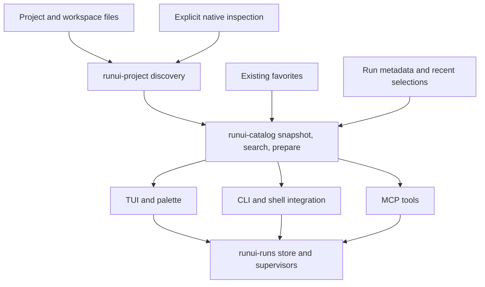

# Command discovery integration plan

Status: proposed. Prepared 26 October 2026 against `main` at `b96cb795370cb299ffe8f221f6d56fde53b640f9`.

The confirmed priority is finding the right command faster across projects and monorepos. Make runui a dependable command catalog with search across sources, workspace membership, and explicitly registered projects. Deliver these discovery improvements before arguments, presets, richer execution workflows, or additional agent controls.

The [research](command-discovery-research.md) contains the code findings, local inventory, reproduced cases, and primary-source comparisons. This is an implementation roadmap; the interfaces and commands below are proposed, not shipped behavior.

## Target experience

1. Open runui through the existing tmux `Alt-X` popup or Neovim `Space o x` float.
2. Press `ctrl+p` to search all command sources in the selected scope, favorites, and recent runui runs. Keep `/` as the current view's filter.
3. Search `web dev` or refine with `project:runui`, `source:npm`, `dir:apps/web`, `kind:command`, or `state:running`. Switch between Project, Workspace, and Registered projects scopes. Each result shows its project, source, and folder.
4. Inspect the exact shell command, working directory, defining file, entry file, required inputs, and any discovery limitation. Open the source from an explicit action.
5. Run a complete command directly, or use a run-with-inputs action to supply arguments and variables. Save a named preset when the variation is useful.
6. Reopen runui to follow the same persistent run. For a matching live service, choose to focus it or start another instance; do not silently suppress legitimate parallel builds.
7. Invoke the same catalog entry by ID from the CLI or an agent. Resolve it again before launch and report stale definitions explicitly.

The first palette increment searches one project or workspace. Milestone 3 expands it to registered projects and makes project switching part of the discovery release. Cross-project results always identify the checkout and effective working directory; searching never changes where a selected command will run.

## Design decisions

### Keep discovery and execution distinct

Passive discovery reads files without evaluating project code. It should work with tools missing and report availability separately from command existence. Tool availability is checked in the selected folder's execution environment, including the existing mise wrapper where applicable; a shell `PATH` lookup alone may be misleading.

Native inspection is explicit, uses installed tools, runs outside the TUI update loop, and has time and output limits. It can enrich a passive snapshot rather than replace working results with an empty list after failure. No automatic package installation, config trust, remote include download, or project command execution is part of passive scanning.

The rationale and native command references are in the [tool comparison](command-discovery-research.md#what-to-learn-from-other-tools).

### Use one catalog for three callers

Add `runui-catalog` for the behavior shared by the Rust TUI, CLI, and MCP. This is justified by the three existing callers assembling overlapping lists. Keep source parsing in `runui-project`, favorites in `runui-favorites`, and process supervision in `runui-runs`.

The catalog's small interface should cover loading a snapshot from context and supplied favorites/runs, searching it, and preparing a selected command with inputs. Pass already-read stores or values into it so tests use temporary data. Keep source collectors internal; a dynamic plugin interface is unnecessary.



Return a prepared command compatible with the existing `Store::start(dir, name, command)` interface first. Do not change the supervisor protocol simply to introduce a palette.

### Record identity and provenance

A catalog entry needs:

| Field | Purpose |
| --- | --- |
| Stable versioned ID | Select the same definition without matching a display label or shell string. |
| Source and native name | Preserve the originating tool's task or target name. |
| Entry file and defining location | Distinguish a root Taskfile invocation from the included file defining it. |
| Project, checkout, and workspace context | Support scope switching, cross-project disambiguation, and useful grouping. |
| Effective working directory and execution recipe | Show and run the exact invocation. |
| Origin kind | Distinguish declared tasks, saved commands, recent runs, and generated conveniences such as Cargo build. |
| Inputs and capabilities | Represent arguments, variables, interactive requirements, watch support, and service intent when known. Unknown remains unknown. |
| Availability and diagnostic information | Explain missing tools, partial discovery, and unsupported dynamic declarations. |
| Definition fingerprint | Detect execution-relevant changes between selection and launch. |

Derive identity from a canonical tuple of source, relative entry path, native name or namespace, variant, and execution context. Use an explicitly specified encoding or digest, not Rust's unspecified default hash. Keep identity separate from a fingerprint of execution-relevant content. Partition caches and recent state by canonical checkout root so different worktrees do not share live state accidentally.

Coalesce a favorite badge and recent-use information with a discovered entry only when its execution identity matches. Keep different working directories, arguments, source files, and configurations distinguishable. A run is an execution instance with its own ID; it never becomes a command definition.

### Define discovery completeness

Return a snapshot containing entries, diagnostics, all source dependencies, directory dependencies, and completeness information. Limits should stop work deterministically and report what was omitted. Enforce budgets across the whole scan, not separately inside individual loops.

Track entry files, included files, workspace manifests, relevant lock files and wrappers, and directories where command files can appear. Initially use dependency polling plus a slower bounded reconciliation scan; add a filesystem watcher only if measurements justify the complexity. Debounce refresh, retain the previous usable snapshot during errors, and discard results from an older scan generation.

## Delivery sequence

### 0. Establish the Rust regression and measurement baseline

Scope: preparatory work, before behavior changes.

- Use the Rust implementation as the development target. Run the existing workspace tests, Clippy, and formatting checks; use disposable Rust TUI sessions for interaction checks.
- Preserve [PLAN.md](../PLAN.md) as the historical porting record. New features may evolve independently of the retired Go implementation; preserve existing Rust data and public contracts deliberately.
- Turn the reproduced cases into temporary-fixture regressions during implementation. Capture command counts, scan completeness, cold scan time, and search latency on selected real repositories and synthetic large workspaces.
- Keep personal project paths and commands out of committed fixtures and reports.

Done when the Rust checks pass and the fixture/measurement set is reproducible. No Go source restoration or comparison is a release gate.

### 1. Fix discovery correctness and refresh

Scope: `runui-project::{lib,taskfile}` and Rust TUI refresh plumbing.

- Replace Taskfile's global visited-file suppression with an active include stack for cycles and namespace-aware expansion. The same file under `one` and `two` must contribute both namespaces; a real include cycle must terminate.
- Retain the defining file and include dependencies even when the included Taskfile is suppressed as a standalone command source.
- Invalidate on included-file edits, relevant package-manager lock changes, wrapper changes, and creation/deletion of nested command files.
- Report scan limits, unreadable directories, and unsupported dynamic includes in the richer snapshot. Document intentional changes to existing text and cover them with Rust regression tests.
- Enforce actual folder and file budgets and keep other source results when one parser fails.

Acceptance: two namespaces appear; include cycles terminate; an included edit updates its description; a newly added nested package appears without pressing refresh; package-manager changes update prepared invocations; a truncated scan is visibly partial. Run Rust discovery regression tests for each behavior change.

### 2. Introduce the catalog and palette

Scope: new catalog crate/package, `runui-tui::{lib,rows,view,styles}`, CLI/MCP catalog adapters.

- Normalize existing discoveries, favorites, and recent runui runs into a snapshot with stable IDs and provenance. Preserve existing source-tab order and favorite order outside the palette.
- Add `ctrl+p`, with help text and key dispatch checked against existing bindings. Keep the palette's query, cursor, preview, and escape behavior independent from panel filters.
- Use deterministic ranking: match quality first, then an explicit favorite/recent preference within comparable matches, then stable path/name tie-breaking. Exact and contiguous name matches precede loose description matches. With an empty query, group favorites, recent selections, and the remaining catalog.
- Support tokenized text and the small set of facets above, with a literal escape for text containing colons. Apply fuzzy matching only in the new palette initially.
- Show exact invocation and directory in the preview, along with source, availability, and partial-discovery diagnostics. Provide explicit actions to run, focus a run, copy, or open the definition.
- Deduplicate matching favorite/command results without losing distinct origins. Run rows default to focusing output; rerun is a separate action.

Acceptance: a search finds Taskfile and package results together; exact `test` is not buried by description text; a name repeated across packages remains unambiguous; clearing the palette restores panel selection; navigation never launches a command; TUI/CLI/MCP resolve the same entry consistently. Exercise the Rust TUI at regular and small sizes.

### 3. Cover monorepos and registered projects

Scope: context/root resolution and workspace adapters in `runui-project`, exposed through the catalog.

- Retain the current nearest-project default. Record invocation directory, selected project, workspace root, and repository stop separately.
- Add an explicit Project/Workspace scope switch, preserving favorites' existing folder keys. Use invocation directory to boost nearby package results without hiding workspace matches.
- Resolve pnpm workspace patterns and exclusions and npm/Yarn workspace declarations. Parse only membership-related fields; keep their different semantics explicit.
- Discover declared members beyond depth three. Apply scan budgets, exclude dependency/generated directories, avoid crossing nested Git repositories automatically, and report members outside the allowed root rather than silently traversing them.
- Use a bounded fallback scan for non-workspace sources. Add `.runuiignore` for explicit local discovery policy; in enhanced workspace discovery honor repository ignore rules for incidental scan candidates, while explicitly declared members remain inspectable with an explanation.
- Preserve the existing discovery entry point for regression coverage while callers transition. Change defaults deliberately with documented behavior and Rust tests.

Acceptance: a declared member at depth four is listed; exclusions are obeyed; dependency packages and incidental fixtures do not flood results; nested repositories are not swept in; entering a worktree keeps its paths and history separate; Project and Workspace scopes are clear from a nested package.

#### Registered projects and cross-project search

- Add an explicit project registry in separate versioned local state. A user can register or forget a folder; remembering folders opened in runui is an optional preference. Do not discover unrelated repositories by recursively scanning home.
- Add a project picker and a Registered projects palette scope. Search a bounded passive snapshot for each registered checkout, with `project:` refinement and the project name, checkout, and relative directory visible on every result.
- Qualify cross-project command identities by checkout identity. A picker result carries the project directory, command ID, and definition fingerprint so shell, editor, and launch actions preserve the selected execution context.
- Refresh registered snapshots incrementally outside the UI loop with bounded concurrency and per-project scan budgets. Show partial, stale, missing, or unavailable projects explicitly; cancel obsolete searches and refresh only the selected definition before launch. Never run native inspection across registered projects automatically.
- Keep current-project proximity as a tie-breaker among comparable text matches. An explicit project facet overrides that bias. Keep favorites scoped to their existing folders and merge their search badges without moving or rewriting them.
- Keep separate worktrees distinguishable, including branches when available. Forgetting a project removes its registry/cache association without deleting its files, favorites, runs, or logs.

Acceptance: `dev` finds commands in two registered repositories and a deep monorepo package; `project:` narrows results; duplicate names always show the correct project and working directory; selection launches in the chosen checkout; an unavailable project does not stall others; cross-project search performs no command execution or native inspection. Deliver this milestone before inputs, presets, and orchestration.

### 4. Add sources in evidence-based order

Each source must participate in root detection, dependency tracking, availability diagnostics, search, CLI/MCP output, and compatibility fixtures. Adding only a new parser is incomplete.

| Order | Integration | First increment | Explicit limit |
| --- | --- | --- | --- |
| 1 | Cargo | Workspace/package build, check, test; actual binaries/examples as run actions; optional metadata enrichment | Respect members, exclusions, default members, features, and target selection. Label generated actions. Do not offer `cargo run` for a library with no runnable target. |
| 2 | Gradle | Timeboxed wrapper-based inspection spike, then task groups and qualified paths if reliable | Configuration can execute code or provision dependencies. No automatic inspection at startup and no regex approximation of all tasks. |
| 3 | mise | Task metadata through installed `mise tasks ls --json`; project origin by default | Preserve inheritance and source labels; global tasks require explicit scope. Do not conflate mise environment setup with task discovery. |
| 4 | Just | JSON dump adapter with recipes, modules, descriptions, and parameters | Detect installed version/schema behavior; no promise to evaluate arbitrary Just syntax statically. |
| 5 | Python | Declared console entry points with an identified environment; add Poe/Hatch/tox/nox adapters only with actual project demand | Object references are not shell commands. The presence of pyproject configuration alone does not imply `pytest` or `ruff` commands. |
| 6 | Turbo/Nx enrichment | Link orchestrator targets to package entries and show graph/context metadata | Delegate scheduling and caching; avoid duplicate rows for wrapper scripts and inferred targets. |
| Later | Deno and selected VS Code tasks | Declared tasks and explicitly supported input forms | No unsupported extension task types or automatic variable evaluation. |

Keep native process invocation internal with a fakeable process executor for adapter tests. Set a proposed five-second foreground inspection budget, cancel its process group on timeout, cap captured output, and allow a deliberate longer refresh. Cache by manifest dependencies, tool version, execution environment identity, and checkout root. These limits are product proposals to validate, not measured requirements.

### 5. Add inputs, presets, and CLI control

Scope: catalog preparation, small local preset store, CLI commands, and run actions.

Proposed command surface, separate from the existing human-readable `list`:

```text
runui commands [-C DIR] [--scope project|workspace|registered] [--query TEXT] [--json]
runui find [-C DIR] [--scope project|workspace|registered] [QUERY]
runui projects [add DIR|forget DIR]
runui inspect [-C DIR] [--json] COMMAND_ID
runui run [-C DIR] [--json] COMMAND_ID -- [ARGS...]
runui logs RUN_ID [--follow]
runui stop RUN_ID
runui restart RUN_ID
runui wait RUN_ID [--timeout DURATION]
```

`run` starts a supervised run and returns its ID. `wait` supplies completion/exit semantics for shell automation. `restart` repeats the stored invocation; resolving an updated project definition is a distinct run action. Decide signal exit-code mapping and timeout codes in the CLI contract tests before shipping. Extend parsing only for the new commands so existing usage errors remain stable.

Start inputs with an argument vector and provider-specific variable fields. Encode each value as data when preparing the existing shell string; never concatenate an unquoted user argument. Test each runner's forwarding convention instead of assuming `--` works uniformly. Preserve a deliberate raw shell mode for custom commands.

Extract required variables and parameter defaults when reliable metadata exists. Keep arbitrary interactive prompts out of detached execution. Presets store names and non-secret input choices in separate versioned local state; project-shared presets can follow after the local format stabilizes. Store environment-variable references rather than secret values. Do not add secret-value persistence to the existing run/favorite files.

Acceptance: spaces, quotes, dollar signs, and metacharacters reach the target as literal argument values; missing required fields are reported before launch; an ID selected before a definition change is revalidated; a preset survives a restart; all run controls operate on the same store as the TUI.

### 6. Connect shell, editor, and MCP

Scope: existing CLI and MCP modules, documented integration snippets, followed by a separate dotfiles change.

- Add filtered/paginated `list_commands` results with IDs, definition fingerprints, provenance, and availability. These are pagination fields inside a tool result, independent of MCP's `tools/list` pagination.
- Let `start_run` accept an ID plus structured inputs and optional expected fingerprint. Preserve existing raw-command clients. Reject conflicting input forms. Tool metadata is descriptive and must not widen a client's execution authorization.
- Add cursor-based output reads so repeated polls return new output rather than the same last lines. Define cursor behavior for truncation, UTF-8 boundaries, missing files, and output limits. Keep the existing tail behavior for clients that omit a cursor.
- Add optional read-only MCP mode for discovery and monitoring clients. Keep the current local execution model explicit; changing working directory scope alone is not a sandbox.
- Provide shell completion and a picker action that inserts a safely encoded command into fish/zsh/bash for editing. Return structured selection data rather than asking shell snippets to parse aligned text or `eval` repository text.
- Keep tmux `Alt-X` and Neovim `Space o x` unchanged initially. Add the palette shortcut inside runui; offer a direct `runui find` popup/float later as an explicit dotfiles preference. Source-open actions use argument arrays and a configured editor command, not shell interpolation of file paths.

Acceptance: one ID resolves identically in all three callers; an agent-started run survives disconnect and is visible/stoppable in the TUI; output cursors do not duplicate or skip data in fixture tests; shell insertion handles unusual names and directories; read-only mode cannot start or stop a run.

### 7. Add development-session conveniences independently

Start with inexpensive actions on the existing run model: output search, explicit opening of detected HTTP URLs, copying diagnostics, and focusing an already-running service. Label URLs as detected output, not proof of application readiness. Use the project registry delivered in milestone 3 for these actions; project switching and cross-project search are already part of the discovery release.

Then decide between delegating complex groups to existing Task/Compose/mise/Process Compose definitions or adding native runui groups. Prefer existing project orchestration when it already expresses dependencies. A native group milestone requires a coordinator that survives the UI, its own lock and versioned state, stable child IDs, cycle detection, readiness/timeouts, failure policy, and stop ownership. Reused services must not be stopped as though the group created them.

Interactive terminal support is a separate architecture decision: either hand execution to the user's terminal or add a supervised PTY with explicit attach/detach, resize, input ownership, and logging semantics. The existing file-output supervisor remains suitable for ordinary persistent commands. Do not ship a group coordinator or PTY path as an incidental palette change.

## Persistence and rollout

Keep existing Rust favorites, run files, their formatting, and supervisor handoff readable by the supported Rust releases. Put catalog cache, command-use history, project registry, presets, and any future group state in separate versioned files using the XDG locations, atomic replacement, and appropriate locking. A cache is disposable; malformed cache data must not block discovery or affect run ownership.

Continue to use the existing favorite's command and relative directory as its execution snapshot. An optional sidecar may associate it with a command ID. When the discovered definition changes, show an update action rather than silently rewriting what a favorite runs. Older Rust releases can continue to execute the saved command without understanding catalog metadata.

Ship the catalog and new CLI commands additively in Rust. Roll out enhanced discovery and new sources once their Rust regression, interaction, and persistence checks pass. Document intentional default changes and use versioned migrations when existing saved data needs to change. The retired Go implementation imposes no rollout gate.

## Validation and release gates

| Layer | Required evidence |
| --- | --- |
| Discovery | Temporary fixtures for repeated includes, cycles, dependencies, deep membership, exclusions, nested repositories, missing tools, malformed inputs, and truncation. |
| Catalog | Stable identity across refreshes, deterministic ranking, origin-aware deduplication, stale-definition handling, registered-project scoping, and correct worktree isolation. |
| TUI | Actual key flows, escape/focus restoration, resize and narrow layouts in private Rust tmux sessions. |
| Execution | Literal argument round trips, preserved cwd, real supervisor lifecycle and process-group stopping, concurrent invocations, and restart behavior. |
| Integrations | CLI JSON contracts, MCP ID/raw compatibility and cursor behavior, agent/TUI cross-control, and shell/editor argument handling. |
| Compatibility | Rust fixtures for existing words, layout, keys, and files; existing saved favorites/runs still load, follow, stop, and restart where applicable. |
| Platform | Workspace tests, lint and formatting on macOS and Linux; no use of personal config or run directories. |

Suggested performance targets to measure: a cold passive catalog of 1,000 commands in under 250 ms and a warm query of 10,000 entries in under 16 ms on the development machine. Treat these as starting targets, publish fixture sizes and hardware, and adjust from evidence. Native inspection never blocks navigation. No performance claim has been measured in this research.

Run `task test`, `task lint`, and affected Rust interaction checks before an implementation commit. The research baseline passed 46 existing tests across discovery, TUI, CLI, and MCP. Each implementation increment reruns the applicable Rust checks.

## First implementation slice

Start with milestone 1: repeated-include correctness and complete source dependency tracking in Rust. Next introduce catalog IDs over the existing five sources and ship the palette. Then deliver workspace coverage, the project picker, and search across registered projects as the first discovery release. Add Cargo coverage next; keep inputs, presets, and richer workflow execution behind these discovery milestones.

This yields useful improvements before committing to dynamic language adapters, a new orchestration engine, or a terminal runtime change.
