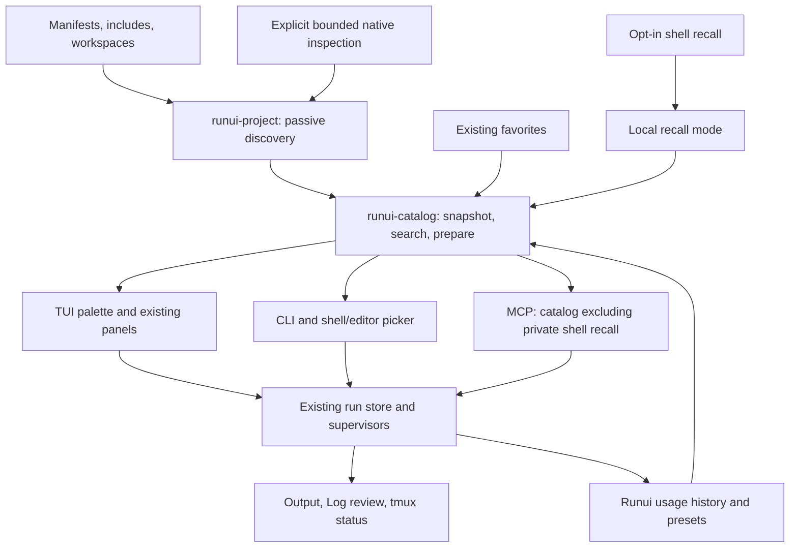

# Command discovery and complete-v1 integration plan

Status: proposed, updated 26 October 2026 against `main` at `326b0c2`. This replaces the sequencing of the earlier `codex/command-discovery-research` plan, whose changes are already on main. Implementation is Rust only. This PR adds research, a reproducible probe, and this plan; the APIs, keys, sources, and storage below remain proposals.

The goal is to find the right command across projects and monorepos, understand exactly what it will run, and return to its result. Composer, Cargo, and user command recall are part of the first complete release. Log, result review, hidden zero tmux counts, agent attribution, six MCP tools, persistent supervisors, and current demos already exist and are the foundation.

Read the [research and primary sources](command-discovery-research.md) for evidence and tool semantics. Use [CONTEXT.md](../CONTEXT.md) for domain terms. Existing [user documentation](index.html) continues to describe shipped behavior.

## What “complete v1” means

| Journey | Release requirement |
| --- | --- |
| Find | One palette searches the existing five sources, Composer, Cargo actions/aliases, favorites, and recent runui invocations. Project, Workspace, and Registered projects scopes make duplicate names unambiguous. |
| Understand | Every result exposes source, checkout, directory, exact invocation, origin kind, availability, and discovery limitations. File existence and tool availability are separate facts. |
| Prepare | Supply arguments, supported tool-specific inputs, and named local presets. Revalidate stale definitions and show effective cwd before launching. |
| Recall | Recent runui usage persists independently of pruned output. Opt-in fish recall works with unknown cwd and preserved dialect. Existing Ctrl-R/fzf remains usable. |
| Run and return | Existing persistent supervision, stop, output, Log review, and tmux status work across TUI/CLI/MCP. Focus an existing live run or deliberately start another. |
| Use elsewhere | CLI JSON/picker results and MCP resolve the same catalog IDs. Shell/editor insertion preserves the chosen context. Existing raw-command MCP clients still work. |
| Recover | Missing tools, partial discovery, malformed files, stale checkouts, and cancelled inspection leave usable results and explain the limitation. Interactive commands have an explicit terminal handoff. |
| Learn | README, static HTML guide, help, and real captures explain the final behavior after implementation. Examples remain runnable without personal configuration. |

Broader adapters (Gradle, mise tasks, Just, Python task tools, framework consoles, Turbo/Nx, Deno), persistent PTY attachment, remote execution, and durable service groups are follow-on work. V1 is a finished everyday journey, not a promise to support every command system.

## Proposed user experience

Keep the four panels: Favorites, Project, Runs, Log. Keep `/` as the current view's filter. Add `ctrl+p` for a palette independent of those selections, with modes **Commands**, **Recent**, and **Shell history**. Shell history stays disabled until selected/configured; ordinary command search does not read personal shell files.

```text
Commands   [Workspace ▾]                              project:shop test
─────────────────────────────────────────────────────────────────────
★ test       composer   shop / backend          Script · recently used
  test       cargo      shop / engine           Generated · package
  test       npm        shop / apps/web         Script
─────────────────────────────────────────────────────────────────────
composer run-script test -- --filter Invoice
cwd: <selected checkout>/backend      source: composer.json · scripts.test
Ready · PHP and Composer resolved in this project
Enter Run   … Inputs / Save preset / Copy / Open source / Open terminal
```

This is a layout sketch, not a screenshot or a required literal key map. Validate bindings against existing input modes before shipping. At narrow sizes, use one list and a toggled detail view rather than truncating execution context invisibly.

- Empty query shows favorites and recent invocations, then remaining definitions; explicit modes can show the full chronological list.
- Search text across sources; support `project:`, `source:`, `dir:`, `kind:`, and `state:` facets, with a literal escape for colons. Recognized facets have completion; arbitrary command text is not parsed as facet syntax accidentally.
- Rank by textual relevance first, favorite/recency/frequency within comparable matches, then nearby project/package and stable path/name tie-breaks. Exact names must beat weak description matches. Keep scoring deterministic and explainable; measure before tuning weights.
- Show the project and relative directory on each cross-project result. Two worktrees remain visibly distinct, with branch labels when available. Searching never changes a selected entry's cwd.
- Run rows focus their output by default. Rerun is a separate action. A matching live service offers Focus or Start another; parallel test/build invocations remain valid.
- Recent rows show their actual arguments, cwd, dialect, time, and outcome when known. Offer Repeat exact invocation and Run current definition as distinct choices after a definition changes.
- Shell rows show the originating shell and known/unknown directory. Default Enter inserts for editing in a matching shell; otherwise Copy is available. Supervised replay goes through preparation with a chosen cwd and supported shell context.
- Viewing finished results in Log or an output pane retains existing review behavior. Merely searching a result is not another launch, and a running result is never acknowledged in advance.

First-use education should fit in the palette: scope explanation, source labels, and a link/action to discovery diagnostics. Do not add a setup wizard before existing command tabs work.

## Module and data design

### One catalog, three callers

Add a deep `runui-catalog` module/crate with a small interface: **snapshot(context, inputs)**, **search(snapshot, query)**, and **prepare(selection, inputs)**. Exact Rust types are implementation work; these three operations are the design contract. Hide ranking, identity, deduplication, and stale-definition handling behind it. Dynamic plugins and a generic framework are unnecessary.

`runui-project` owns source parsing, root/workspace resolution, and discovery dependencies. `runui-favorites` and `runui-runs` keep their current responsibilities. Introduce usage/history storage behind one internal interface first; extract another crate only if sharing or test locality makes that worthwhile. Source adapters stay internal and are tested through observable discovery/preparation results.



Pass context and already-read stores/values into these operations. File reads, clock, and optional process inspection need replaceable seams for temporary-fixture tests. Do not hide access to personal HOME, runs, or history inside pure ranking functions.

For ordinary provider commands, prepare an argument vector/tool recipe, then encode it correctly for the existing shell-string launch contract. Keep a deliberate raw-shell recipe for custom commands. `Store::shell` already records shell selection in run metadata; use that existing capability for supported replay rather than adding a new supervisor protocol for the palette. Shell startup/environment behavior still needs explicit tests.

### Identity, provenance, and freshness

| Concept | Required representation |
| --- | --- |
| Definition identity | Versioned deterministic encoding/digest of source, entry path relative to context, native name/namespace, variant, and execution context. Never use a display label, rendered shell text alone, or Rust's unspecified default hash. |
| Checkout identity | Canonical selected checkout root, distinct from repository remote and branch. Qualify cross-project selections by checkout; branch is descriptive, not identity. Handle unavailable paths without merging them. |
| Definition fingerprint | Execution-relevant content/dependencies, separate from identity. A changed description need not create a new definition. Revalidate before launch and return a structured stale result when preparation changed. |
| Provenance | Entry file and defining file/location when known; native key; declared/generated/saved origin. Taskfile entry and included definition can differ. Unknown location stays unknown. |
| Execution context | Effective cwd, tool/environment selection, recipe kind, supported inputs, interactive capability, availability. A candidate is discoverable even if its tool is missing. |
| Invocation | Exact prepared values plus definition reference when known. Arguments or cwd changes remain visible; a raw saved command need not have a discovered definition ID. |
| Run | Existing unique run ID and lifecycle. It is an instance, not a catalog definition. |

Keep existing favorite order and folder keys; catalog references can live in sidecar state without rewriting favorites. Merge favorite badges and usage only for matching execution identities; preserve distinct origins and directories in details. Aliases can point to a canonical definition without producing extra usage counts. Never coalesce two different projects just because both render `npm run test`.

### Discovery completeness and refresh

Return entries plus diagnostics, dependency files/directories, and completeness reasons. Strict budgets apply across the whole scan, with deterministic ordering. Distinguish unsupported dynamic declarations, parse failures, absent tools, ignored candidates, and budget truncation. Keep partial results when one source fails.

Replace Taskfile's global visited-file suppression with an active include stack for cycle detection and namespace-aware expansion. Track included definitions even when they are hidden as standalone source rows. Track lockfiles, wrappers, workspace manifests, selected Cargo config/toolchain files, and directories where definitions can appear.

Start with dependency polling plus a debounced, bounded reconciliation scan. Run scans outside the TUI update loop, keep the last usable snapshot during refresh, cancel obsolete generations, and never let an old result overwrite a new context. Add filesystem watchers only if measurements justify them.

Retain nearest-project behavior as the Project default. Record invocation folder, project root, workspace root, and repository stop separately. Read declared pnpm/npm/Yarn and Cargo membership rather than making depth three the workspace definition. Honor exclusions, avoid automatic traversal across nested repositories or symlinks, and explain members outside the allowed root.

Use bounded fallback scanning for undeclared folders. Add `.runuiignore`; honor repository ignores for incidental candidates in enhanced discovery while allowing explicitly declared members with an explanation. Keep the old discovery entry point during the transition and document deliberate default changes.

### Registered projects

Provide an explicit local registry: add, forget, and select a checkout. Optionally remember folders opened in runui, with that preference visible. Do not scan home to find unrelated repositories. Forgetting removes registry/cache associations, not the project's files or existing runs/favorites.

Search bounded passive snapshots per registered checkout with bounded concurrency. Missing or stale checkouts must not stall the others. Native inspection never runs across every registered project automatically. On selection, refresh only the chosen definition/context before preparing it. Registry entries, fingerprints, and effective cwd travel with picker/CLI results.

### Storage and retention

Keep existing favorites JSON, run metadata, logs, `status.seen`, optional agent fields, and supervisor handoff readable. Add versioned sidecar state for the registry, usage, and presets; cache files are disposable. Do not make the old store understand a new catalog format just to follow or stop an existing run.

Start with bounded, versioned local JSON state using the repository's locking and atomic-write patterns where suitable. Keep usage updates behind one store operation; measure rewrite cost before choosing an append journal or SQLite. Concurrent TUI/CLI/MCP writers and a corrupt/interrupted write are acceptance cases, not deferred details. Never place a huge rewritten shell-history import in this store.

Usage records contain a run ID, optional definition identity/fingerprint, chosen invocation/cwd/shell, launch time, and known outcome. Record only after successful run creation; deduplicate by run ID. Capture outcome on observation/reconciliation while the run exists. Unknown after pruning remains unknown. A partial start error that leaves a run record needs an explicit recorded launch-error state, not a fabricated success.

Use a bounded recent-invocation list and compact aggregate counts per definition/context so usage survives the existing 40-ended-run output policy. Proposed starting limits: 1,000 recent invocations, 180 days of detailed usage, and bounded aggregate keys; validate size and make retention documented/configurable. A recent invocation whose output was pruned says “output no longer retained.” Reviewing notices changes neither frequency nor retention.

Presets store non-secret input choices and environment-variable references, not secret values. Provide local remove/forget operations. Imported personal shell text remains ephemeral unless explicitly saved; any opt-in shell cache needs its own clear retention/clear behavior.

## Source contracts for the first release

### Composer

- Recognize `composer.json` in project roots and nested contexts. Parse `scripts`, `scripts-descriptions`, and `scripts-aliases`, retaining native keys and canonical alias relationships. Exclude dependency manifests under `vendor`.
- Ordinary scripts are default candidates; documented Composer lifecycle events are a distinct hook kind. String, array, callback, `@script`, `@php`, and `@composer` values are delegated intact to Composer, never flattened into shell commands.
- Prepare `composer run-script NAME -- ARGS` with literal argument handling and exact cwd. Show the selected manifest. Nondefault manifests and a project-local Composer PHAR require explicit, validated context/tool selection; do not assume an executable launcher proves PHP availability.
- Track manifest changes and relevant selected environment/wrapper changes. Resolve readiness in the project's environment, including mise where applicable. Missing PHP is a useful availability diagnostic, not an empty source.
- Validate explicit native inspection with `--no-plugins --no-scripts`, deadlines, output caps, and supported versions. Do not auto-run install/update or plugin code on palette open.
- Honor Composer's timeout policy. Offer an explicit timeout preset for long-lived scripts only when requested; show the resulting command.

Acceptance fixtures: string and array scripts; callback/reference helpers; descriptions/aliases; lifecycle vs similarly named custom script; quoted names/arguments; nested projects; vendor exclusion; missing PHP/Composer; alternative manifest; partial malformed input. Native execution tests must use disposable Composer/PHP fixtures with no downloaded packages. Local research did not validate execution because PHP was missing from the inspection shell.

### Cargo

- Use an established TOML parser for package and virtual-workspace manifests; resolve members, excludes, default members, package names, and checkout scope. Preserve invocation cwd separately from manifest selection.
- Offer labeled generated build/check/test actions at package/workspace scope. Avoid implicit `--workspace` or `--all-features`. Offer runnable binaries/examples only when target kind supports execution; expose required features and ambiguous target selection.
- Read applicable alias configuration with origin labels and correct parent/CARGO_HOME precedence. String, array, recursive, and shell aliases are passed to Cargo rather than independently interpreted. Global aliases are an explicit scope.
- Use installed-tool metadata only as explicit enrichment: versioned JSON, `--no-deps --offline --locked`, timeout, bounded output, and no automatic toolchain provisioning. Treat package IDs as opaque. Keep static fallback results with completeness diagnostics when enrichment fails.
- Separate provider flags (`--package`, `--bin`, `--features`, etc.) from program arguments after `--`. Track manifests, lockfiles, applicable config, and toolchain selection. Use subprocess cwd; avoid Cargo's nightly `-C` requirement.

Acceptance fixtures: this seven-member workspace; virtual and root-package workspaces; excluded/deep/default members; library-only package; multiple binaries/default-run; runnable and library examples; test/bench targets; required features; duplicate package labels; configuration precedence/aliases; missing lock/cache/toolchain; paths with spaces; distinct runtime cwd. Compare explicit enrichment to Cargo's own metadata on disposable fixtures.

### User command history

Ship runui usage history with the palette. Add opt-in **fish** recall as the first external history adapter, because it matches the actual workflow. Zsh/Bash follow after format fixtures; Atuin is an optional enrichment adapter, not a dependency of basic recall.

- Preserve original command text, origin/dialect, known timestamp, known cwd, and known outcome. Native shell-history `paths` is not cwd. Unknown cwd entries stay under Shell history/All history and cannot appear as verified project matches. Never infer cwd by replaying preceding `cd` entries from interleaved sessions.
- Read a bounded tail or use a verified native query; tolerate multiline values, escape sequences, invalid bytes, interrupted writes, rotation, and format changes. Do not use a generic YAML parser for fish's backend or line splitting as a general Bash/Zsh decoder. Report partial/unsupported format rather than inventing entries.
- Default action inserts for editing in the matching shell. A pure CLI picker emits a structured selection; fish integration uses `commandline`, with appropriate zsh/Bash equivalents when supported. No silent Ctrl-R rebinding. No command execution during selection or shell quoting conversion by guesswork.
- For supervised replay, prepare a chosen cwd and supported shell command context; show that functions/aliases/environment may differ from the original interactive session. Permit copying or external-terminal handoff when faithful replay is unavailable.
- Deduplicate display by exact text plus dialect and known cwd, retaining source/time information. Do not treat stored record count as execution frequency. Save as favorite is deliberate promotion to the shared catalog; private history is excluded from MCP by default.
- Render control characters safely in list/preview. Do not execute command substitutions to generate previews, evaluate shell entries, mutate the source history, or launch shell startup files automatically merely to parse stored records.

A later opt-in capture hook can record cwd, dialect, exit code, and duration for new shell commands. It must coexist with current hooks and honor disabled/private history. A timeboxed Atuin spike must establish lossless record/field transport against the installed version; custom TSV is not sufficient for arbitrary commands. Do not access an undocumented private SQLite schema as the default adapter.

Acceptance: fake fish/zsh/Bash files only; multiline/Unicode/escapes; timestamp ambiguity; corrupted tail; concurrent append and rotation; no-cwd display and explicit cwd choice; fish syntax never executed under sh; source files unchanged; disabling history stops reads; history absent from MCP; saving a favorite preserves the chosen context.

## Execution, CLI, shell/editor, and MCP

The proposed CLI surface adds structured discovery without changing today's human `list` output:

```text
runui commands [-C DIR] [--scope project|workspace|registered] [--query TEXT] [--json]
runui find [-C DIR] [--scope ...] [--mode commands|recent|shell] [QUERY]
runui projects [add DIR|forget DIR]
runui inspect [-C DIR] [--json] COMMAND_ID
runui run [-C DIR] [--json] COMMAND_ID -- [ARGS...]
runui logs RUN_ID [--follow]
runui stop RUN_ID
runui restart RUN_ID
runui wait RUN_ID [--timeout DURATION]
```

Define JSON schema version, pagination, selection context, error/exit mapping, and literal argument forwarding in CLI contract tests. `run` returns a supervised run ID; `wait` provides completion semantics for automation. Restart repeats the stored invocation; running an updated definition is a separate action. Never serialize argv by joining unquoted strings. Raw shell mode remains deliberate for saved/custom commands.

For shell/editor pickers, return ID plus checkout, fingerprint, invocation, and insertion dialect as structured data. Multi-line text needs a length-delimited or JSON transport, not a shell-evaluated line. Insertion for another project must preserve cwd through an explicit dialect-correct wrapper or chosen context action. Supply snippets first; change personal dotfiles separately when adopted.

Extend MCP using the same catalog: filtered/paginated command results with IDs, provenance, fingerprints and availability; ID-plus-inputs start alongside the current raw-command form; reject conflicting forms. Public catalog queries never include private shell recall by default. Preserve client agent attribution and existing run controls. Discovery metadata describes commands; it does not expand a client's execution authorization.

Add cursor-based output reads with defined UTF-8, truncation, missing-file, size-limit and end-of-run behavior; retain tail reads for clients omitting a cursor. Define run-list filters/pagination without confusing result pagination with MCP `tools/list` pagination. Reading output remains read-only by default. If an explicit review operation is added, it shares the finished-only guard; agents must not clear human notices merely by polling.

Offer Open terminal for interactive commands. The current log/output pane has no PTY and cannot promise terminal interaction. Persistent PTY attachment, ownership/reconnection, terminal size, stdin, and stop semantics are a separate design. Likewise, any future service-group coordinator must persist outside the TUI and define readiness, failure propagation, recovery, and stopping.

## Delivery as reviewable PRs

Sizes are relative engineering complexity (S/M/L), not calendar estimates. Each slice must leave current panels and raw launches usable. No slices require work in Go.

| PR | Scope and primary files | Depends on | Acceptance gate | Size |
| --- | --- | --- | --- | --- |
| 1 | Correct Taskfile namespaces, source dependencies and strict budgets: `runui-project/{lib,taskfile}`; TUI refresh plumbing | Current main | Reproduced namespace/edit/new-file cases become regressions; real cycles terminate; partial results and truncation visible | M |
| 2 | `runui-catalog` over existing sources/favorites/runs, identity/provenance, snapshot/search/prepare; usage store seam | 1 | Deterministic IDs/ranking, cwd isolation, stale selection, temporary stores, existing data loads | M |
| 3 | Palette, modes, previews, usage recording; `runui-tui/{lib,rows,view,styles}` | 2 | Cross-source search, exact-name ranking, no navigation launch, live focus/rerun distinction, narrow terminal checks | L |
| 4a | Workspace context and pnpm/npm/Yarn declared membership in `runui-project` | 2 | Deep/excluded members, nested repositories, manifest additions, scope switching | M |
| 4b | Registry/project picker and bounded cross-project catalog snapshots | 3, 4a | Two repos plus two worktrees with duplicate names; chosen cwd preserved; one unavailable project does not stall | M |
| 5 | Composer parser/root/preparation/diagnostics and catalog integration | 2 | Composer fixtures above; default hooks policy; no native execution during passive discovery | M |
| 6a | Cargo roots/workspaces, generated actions and target discovery; static completeness | 2, context from 4a | Library-only/runnable/default-members/required-features behavior; runui discovers its own Rust workspace | L |
| 6b | Explicit Cargo metadata and effective alias enrichment, bounded process executor | 6a | Offline/missing toolchain fallback, aliases/config precedence, no navigation stalls | M |
| 7 | Opt-in fish recall, local picker mode, shell insertion; history fixtures | 3 | Unknown cwd stays unknown; no sh translation; no source writes; multiline/rotation behavior | M |
| 8a | Inputs/local presets and CLI JSON/run/wait/control contracts | 2, 5, 6a | Literal argv round trips; stale preparation; correct cwd; saved variations | M |
| 8b | Shared MCP catalog/ID launch, output cursors, editor/shell context integration | 4b, 8a | Raw-client compatibility, bounded output, same IDs/results across all callers, private history absent | M |
| 9 | Hardening, diagnostics UI, onboarding/help, README/HTML and new isolated captures | All v1 slices | Complete journey matrix, measured budgets, macOS/Linux CI, docs reflect shipped behavior only | M |

Start with PR 1's include expansion and dependency tracking, then introduce catalog identity over the five existing sources. Do not block the first useful palette on every new parser. Composer and Cargo must nevertheless ship before calling the complete-v1 goal achieved; they precede long-tail tools. Runui usage is part of the initial palette, and fish recall follows it rather than being postponed indefinitely.

PR 4a/4b can proceed as distinct increments after catalog context is stable; PR 5 and 6 share that context and preparation contract. Freeze those small interfaces before extending native inspection. Integrate each completed slice with focused validation rather than landing all changes as one unreviewable rewrite.

## Release verification and measurement

| Layer | Evidence required |
| --- | --- |
| Discovery | Temporary-fixture namespace/cycle/refresh, membership/exclusion, malformed input, strict budget and diagnostic checks; Composer and Cargo contracts above. |
| Catalog | Deterministic ranking/identity, alias/favorite deduplication, stale preparation, correct scopes, registry outage and worktree isolation. |
| History/state | Launch recorded once across callers; concurrent writes; corrupted sidecar recovery; Log pruning does not erase usage; reviewing never increases use; no personal source mutations or MCP exposure. |
| TUI | Real Rust sessions in private tmux: open palette, query, switch scope, preview, cancel/restore focus, prepare, run, close/reopen, review Log; small/large sizes. |
| Execution | Literal argv and cwd round trips; real supervisor persistence/process-group stop; concurrent launches, restart, missing tools, unsupported interaction handoff. |
| Integrations | Versioned CLI JSON and exit semantics; MCP raw/ID compatibility, pagination/cursors, agent attribution, shared control; fish/editor insertion without shell evaluation. |
| Compatibility | Existing favorites, metadata, status files, logs and live supervisors remain readable/controllable. Existing keys and normal `list` output preserved unless deliberately documented. |
| Product | README/help/static HTML/captures agree; users can find, launch, return, review, and repeat Composer/Cargo/package commands in nested and registered projects. |

Run `task test` and `task lint` before implementation commits; the current research baseline passes **233 Rust tests**, Clippy with warnings denied, and formatting. The research probe prints seven fixture observations. No Go comparison is required.

Measure cold snapshot time, refresh work, warm query time, memory, cancellation latency, and history import size independently. Proposed initial targets on a documented development machine: a 1,000-command passive snapshot under 250 ms; a warm query over 10,000 entries under 16 ms; no synchronous native inspection on navigation. These are unmeasured starting budgets, not claims or universal hardware guarantees. Use synthetic scale fixtures and representative active repositories without publishing personal commands or paths.

Before declaring v1 complete, time the same find-and-run tasks before and after: a duplicate `test` across sources, a deep workspace package, a command in another registered checkout, a Composer script with arguments, a Cargo binary with features, and an old fish command whose cwd is unknown. Record misses, wrong-directory prevention, and extra key steps as well as speed. Failed discovery must be explainable rather than look like an empty project.

## Follow-on decisions

- Timebox native Gradle, mise, Just, and Symfony metadata adapters, choosing the next from active-project demand. Add Python task-tool, Turbo/Nx, Deno, and editor-task support through the same catalog rather than extra independent menus.
- Add output search and detected URL actions to the existing output pane after the find/run journey works. Ensure text is treated as data and actions are explicit.
- Evaluate rich Atuin recall or future shell capture only after the fish flow proves useful. Validate versioned transport and hook coexistence before shipping.
- Design persistent interactive sessions and durable groups independently; keep those designs honest about lifecycle and ownership. Use external terminal handoff and existing Compose/tool orchestration in v1.
- Revisit usage-store format and filesystem watchers from measured costs. Do not preemptively add a database, plugin ABI, build cache, or inferred AI command generator.
